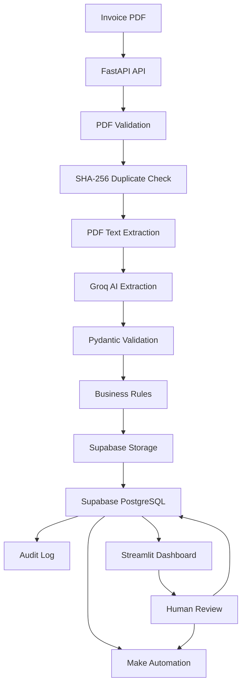
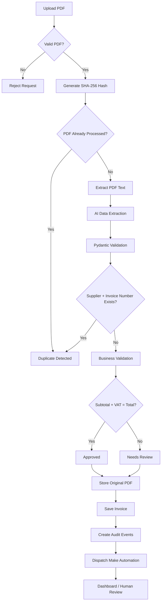
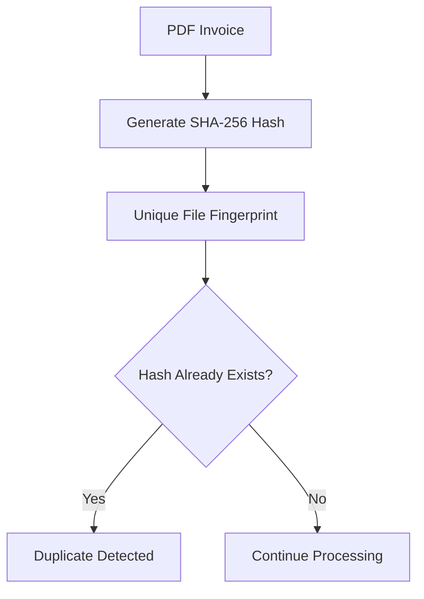
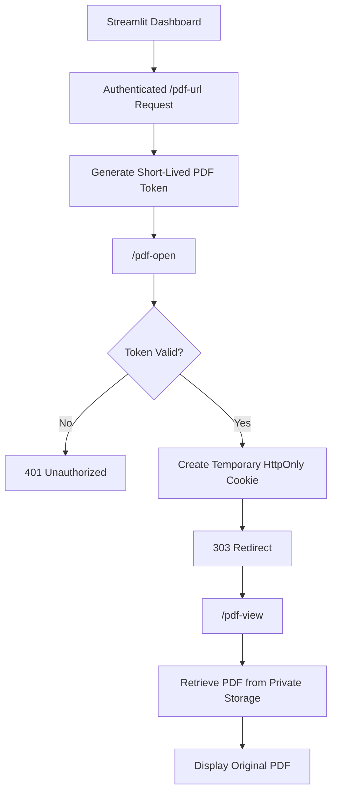
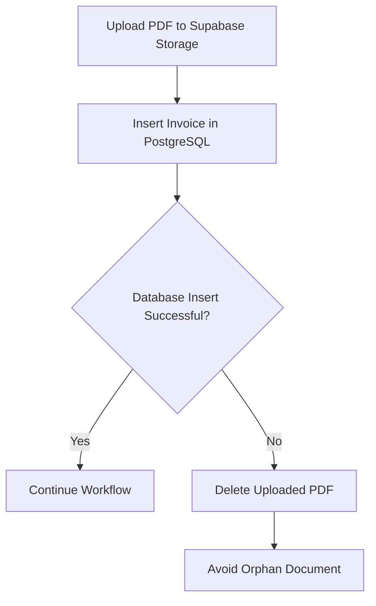
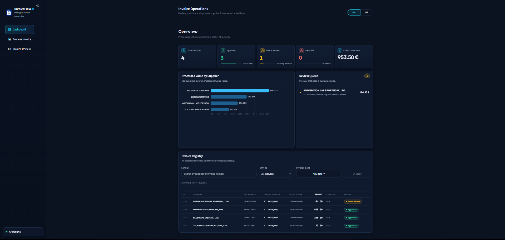
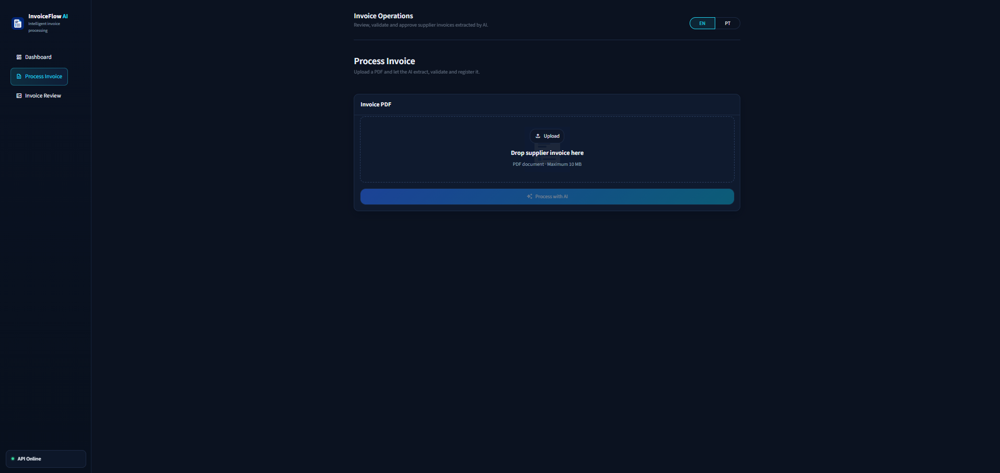
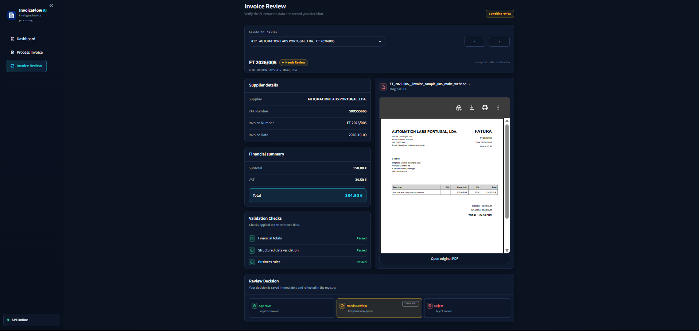

# InvoiceFlow AI

InvoiceFlow AI is an intelligent invoice processing system designed to automate the reception, extraction, validation, storage and review of supplier invoices.

The project combines **Process Automation, Systems Integration, AI, Data Validation and Document Management** in a complete end-to-end workflow.

It was developed as a portfolio project to demonstrate practical skills in backend development, API integration, workflow automation, databases, AI services, testing and resilient system design.

---

## Features

InvoiceFlow AI currently supports:

- PDF invoice upload
- PDF text extraction
- Structured invoice data extraction using AI
- Pydantic data validation
- Business rule validation
- Duplicate invoice detection
- PostgreSQL persistence with Supabase
- Private PDF storage with Supabase Storage
- Human review workflow
- Integration with Make automation scenarios
- Audit logging
- Dashboard-to-API authentication with `X-API-Key`
- Secure temporary PDF access with short-lived tokens
- Bilingual dashboard (English / Portuguese)
- Service failure handling
- Automated tests with pytest
- Code quality checks with Ruff
- Continuous integration with GitHub Actions

---

## Architecture

The system follows a modular architecture where each component has a specific responsibility.



---

## Invoice Processing Flow



---

## Technology Stack

### Backend

- Python
- FastAPI
- Pydantic
- Uvicorn

### Artificial Intelligence

- Groq API
- `openai/gpt-oss-20b`

The AI layer converts unstructured invoice text into structured invoice data.

### Database

- Supabase
- PostgreSQL

Invoice records, statuses and audit events are persisted in PostgreSQL.

### Document Storage

- Supabase Storage

Original invoice PDFs are stored in a private bucket and are never exposed publicly.

### Automation

- Make

Processed invoices and human review decisions can trigger external automation workflows.

### Dashboard

- Streamlit
- Pandas

The dashboard provides invoice monitoring, filtering and human review functionality.

### Testing

- pytest
- FastAPI TestClient
- monkeypatch / mocks

External services are mocked during automated tests so tests do not call Groq, Make or Supabase.

### Code Quality and CI

- Ruff
- GitHub Actions

Ruff is used for static code quality checks and import validation.

GitHub Actions automatically runs linting and the test suite on pushes and pull requests to `main`.

---

## Project Structure

```text
invoiceflow-ai/
│
├── .github/
│   └── workflows/
│       └── ci.yml
│
├── .streamlit/
│   └── config.toml
│
├── api/
│   ├── core/
│   │   ├── auth.py
│   │   ├── errors.py
│   │   └── pdf_access.py
│   │
│   ├── icon/
│   │   └── favicon.png
│   │
│   ├── models/
│   │   ├── invoice_status.py
│   │   └── invoice.py
│   │
│   ├── routes/
│   │   ├── dashboard.py
│   │   ├── general.py
│   │   ├── invoices.py
│   │   └── processing.py
│   │
│   ├── services/
│   │   ├── ai_service.py
│   │   ├── audit_service.py
│   │   ├── database_service.py
│   │   ├── invoice_processing_service.py
│   │   ├── invoice_validation_service.py
│   │   ├── make_service.py
│   │   ├── pdf_service.py
│   │   ├── storage_service.py
│   │   └── supabase_client.py
│   │
│   └── main.py
│
├── dashboard/
│   ├── assets/
│   │   ├── icon/
│   │   │   └── favicon.png
│   │   │
│   │   └── styles/
│   │       ├── base.css
│   │       ├── buttons.css
│   │       ├── components.css
│   │       ├── dashboard.css
│   │       ├── feedback.css
│   │       ├── invoice_review.css
│   │       ├── process_invoice.css
│   │       ├── registry.css
│   │       └── sidebar.css
│   │
│   ├── core/
│   │   ├── api_client.py
│   │   ├── i18n.py
│   │   ├── status.py
│   │   └── ui.py
│   │
│   ├── views/
│   │   ├── dashboard_components/
│   │   │   ├── invoice_registry.py
│   │   │   ├── metrics.py
│   │   │   ├── review_queue.py
│   │   │   └── supplier_chart.py
│   │   │
│   │   ├── invoice_review_components/
│   │   │   ├── decision_panel.py
│   │   │   ├── invoice_details.py
│   │   │   ├── pdf_panel.py
│   │   │   └── review_header.py
│   │   │
│   │   ├── dashboard.py
│   │   ├── invoice_review.py
│   │   └── process_invoice.py
│   │
│   └── app.py
│
├── docs/
│   └── screenshots/
│       ├── dashboard-overview.png
│       ├── process-invoice.png
│       └── process-review.png
│
├── make-workflows/
│   ├── invoiceflow-workflow.png
│   └── README.md
│
├── sample-invoices/
│   ├── invoice_sample_001.pdf
│   ├── invoice_sample_002_valid.pdf
│   ├── invoice_sample_003_needs_review.pdf
│   ├── invoice_sample_004_duplicate_number.pdf
│   └── invoice_sample_005_make_webhook.pdf
│
├── tests/
│   ├── conftest.py
│   ├── test_duplicates.py
│   ├── test_invoice_model.py
│   ├── test_invoice_validation.py
│   └── test_service_errors.py
│
├── .env.example
├── .gitignore
├── .python-version
├── pyproject.toml
├── README.md
├── requirements-dev.txt
└── requirements.txt
```

---

## Data Extracted From Invoices

The AI extraction layer converts invoice content into a structured model containing:

```json
{
  "supplier_name": "Example Supplier Lda",
  "supplier_vat_number": "PT509123456",
  "invoice_number": "FT-2026-001",
  "invoice_date": "2026-10-13",
  "subtotal": 100.00,
  "vat_amount": 23.00,
  "total": 123.00,
  "currency": "EUR"
}
```

The extracted data must pass Pydantic validation before continuing through the workflow.

---

## Business Validation

InvoiceFlow AI applies business validation rules after AI extraction.

One of the main validation rules verifies:

```text
subtotal + VAT = total
```

For example:

```text
Subtotal:     100.00 EUR
VAT:           23.00 EUR
Total:        123.00 EUR
```

If the calculated amount matches the invoice total, the invoice can be automatically approved.

If the values do not match, the invoice is marked as:

```text
needs_review
```

and can be reviewed manually through the dashboard.

---

## Duplicate Detection

The system prevents the same invoice from being processed multiple times using two mechanisms.

### File fingerprint

Every uploaded PDF receives a SHA-256 hash.



If the same PDF is uploaded again, the API returns a duplicate response.

### Business identifier

Invoices are also checked using:

```text
supplier_vat_number + invoice_number
```

This prevents the same invoice from being inserted using a different PDF file.

---

## Document Storage

Original invoice PDFs are stored in a private Supabase Storage bucket.

Example storage structure:

```text
invoice-documents/
└── 2026/
    └── 10/
        └── 509123456/
            └── FT-2026-001__invoice.pdf
```

Documents are not publicly accessible.

PDFs are retrieved through the FastAPI backend instead of exposing Supabase Storage URLs directly to the browser.

When a user opens an original invoice from the dashboard, the authenticated API generates a short-lived application token. The browser exchanges this token for a temporary HttpOnly cookie and is redirected to a clean PDF URL.

This allows the PDF to remain protected while avoiding exposure of the internal API key or Supabase Storage URLs.

---

## Security

InvoiceFlow AI includes service-to-service authentication between the Streamlit dashboard and the FastAPI backend.

### Dashboard-to-API authentication

Protected API endpoints require the following HTTP header:

```text
X-API-Key
```

The Streamlit dashboard automatically includes this key when communicating with the API.

Requests to protected endpoints without a valid key return:

```text
401 Unauthorized
```

General health endpoints remain publicly accessible so the application can expose basic availability information without revealing invoice data.


### Secure PDF access

Opening a PDF directly from a browser requires a different mechanism because browser links cannot attach the private `X-API-Key` header.

InvoiceFlow AI therefore uses short-lived HMAC-signed access tokens.



The temporary token expires after five minutes.

The API key is never placed in the browser URL, and Supabase Storage URLs are not exposed to the user.

---

## Human Review

Invoices requiring manual review can be handled directly from the Streamlit dashboard.

A reviewer can change the invoice status to:

```text
approved
needs_review
rejected
```

Status changes are:

1. persisted in PostgreSQL;
2. registered in the audit log;
3. dispatched to the Make automation workflow.

---

## Audit Log

Important events throughout the invoice lifecycle are registered in the `audit_logs` table.

Examples include:

```text
invoice_received
duplicate_detected
ai_extracted
ai_processing_failed
validation_completed
document_stored
document_storage_failed
invoice_created
approved
needs_review
rejected
automation_dispatched
automation_failed
database_operation_failed
```

This provides traceability across the processing pipeline.

---

## Failure Handling

InvoiceFlow AI includes explicit failure handling for external dependencies.

### AI service

The Groq integration implements:

- request timeout;
- automatic retries for temporary failures;
- rate limit handling;
- connection failure handling;
- invalid AI response handling;
- configuration error handling.

Internal exception details are not returned to the dashboard.

### Database

Supabase database operations are wrapped in service-specific exceptions.

The API distinguishes between:

```text
temporary service failure
configuration failure
database operation failure
```

and returns safe HTTP responses without exposing credentials or internal implementation details.

### Document Storage

Supabase Storage operations use the same controlled error-handling approach.

If the PDF is successfully uploaded but the database insert subsequently fails, the API performs a compensating action:



This keeps Storage and Database state consistent.

### Audit logging

Audit logging is intentionally non-blocking.

A failure while creating an audit event must not interrupt the primary invoice workflow.

---

## Automated Tests

The project uses `pytest` for automated testing.

The current test suite covers:

- valid Pydantic invoice models;
- invalid invoice data;
- negative monetary values;
- invalid currency codes;
- invalid dates;
- valid invoice totals;
- subtotal / VAT / total mismatches;
- decimal amount validation;
- duplicate PDF detection;
- duplicate invoice number detection;
- database error mapping;
- storage error mapping;
- AI service availability failures;
- PDF rollback when database persistence fails.

Run the tests with:

```bash
python -m pytest -v
```

Current test suite:

```text
16 passed
```

External services are mocked, so running the tests does not consume Groq requests or modify production Supabase data.

---

## Running the Project Locally

### 1. Clone the repository

```bash
git clone https://github.com/pedrocunha4/invoiceflow-ai.git
cd invoiceflow-ai
```

### 2. Create a virtual environment

Windows:

```bash
python -m venv .venv
.venv\Scripts\activate
```

macOS / Linux:

```bash
python3 -m venv .venv
source .venv/bin/activate
```

### 3. Install dependencies

```bash
pip install -r requirements.txt
```

For development and testing:

```bash
pip install -r requirements-dev.txt
```

### 4. Configure environment variables

Create a `.env` file based on:

```text
.env.example
```

Never commit the real `.env` file.

### 5. Start the FastAPI backend

```bash
uvicorn api.main:app --reload
```

The API will be available at:

```text
http://127.0.0.1:8000
```

Swagger documentation:

```text
http://127.0.0.1:8000/docs
```

### 6. Start the Streamlit dashboard

In another terminal:

```bash
streamlit run dashboard/app.py
```

---

## Environment Variables

The project requires the following environment variables:

```env
GROQ_API_KEY=
SUPABASE_URL=
SUPABASE_SECRET_KEY=
MAKE_WEBHOOK_URL=
MAKE_WEBHOOK_API_KEY=

INVOICEFLOW_API_URL=http://127.0.0.1:8000
INVOICEFLOW_API_KEY=
INVOICEFLOW_PDF_TOKEN_SECRET=
```

`INVOICEFLOW_API_KEY` authenticates communication between the Streamlit dashboard and FastAPI.

`INVOICEFLOW_PDF_TOKEN_SECRET` is used to cryptographically sign temporary PDF access tokens.

Strong random values can be generated with:

```bash
python -c "import secrets; print(secrets.token_urlsafe(32))"
```

Real credentials must never be stored in Git.

---

## Technical Decisions

### Why FastAPI?

FastAPI provides a lightweight API layer with native Pydantic integration, automatic OpenAPI documentation and clear separation between HTTP endpoints and business services.

### Why Pydantic?

AI output cannot be assumed to be valid.

Pydantic acts as a validation boundary between probabilistic AI extraction and deterministic application logic.

### Why SHA-256?

A SHA-256 fingerprint allows the application to efficiently identify an exact PDF that has already been processed.

### Why Supabase?

Supabase provides PostgreSQL and private object storage in the same platform while preserving a clear separation between structured invoice data and original documents.

### Why private document storage?

Invoices may contain sensitive business information.

Documents are therefore stored in a private bucket rather than exposed through public URLs.

### Why Make?

Make demonstrates the integration of the application with external process automation workflows without coupling business automation directly to the API.

### Why separate services?

External integrations are separated into dedicated modules:

```text
AI
Database
Storage
Automation
PDF processing
Audit logging
```

This makes the system easier to test, maintain and extend.

### Why API key authentication?

The Streamlit dashboard acts as a trusted client of the FastAPI backend.

A shared API key provides a lightweight authentication boundary between both components without introducing a complete user authentication system that is outside the scope of this portfolio project.

Sensitive invoice and processing endpoints therefore require an `X-API-Key` header.

### Why short-lived PDF access tokens?

A browser opened through a normal link cannot include the private `X-API-Key` header.

For this reason, authenticated dashboard requests can generate a short-lived HMAC-signed token specifically for PDF access.

The token is validated by the API, exchanged for a temporary HttpOnly cookie and removed from the visible URL through a redirect.

This keeps the API key private and prevents direct exposure of Supabase Storage URLs.

### Why compensating actions?

Storage and PostgreSQL are separate systems and therefore do not share a database transaction.

If Storage succeeds but database persistence fails, deleting the uploaded file acts as a compensating transaction and prevents inconsistent state.

---

## Limitations

InvoiceFlow AI is currently a portfolio-oriented implementation and not a production accounting platform.

Current limitations include:

- no end-user authentication or user accounts;
- no role-based access control;
- no OCR pipeline for image-only scanned invoices;
- AI extraction may require human review for ambiguous documents;
- no persistent retry queue for failed automation events;
- Make webhook acceptance confirms dispatch, not completion of the entire Make scenario;
- business validation currently focuses on a limited set of invoice rules;
- deployment and production monitoring are outside the current local development scope.

Possible future improvements include end-user authentication, role-based access control, OCR support, additional validation rules, persistent retry mechanisms, cloud deployment and production monitoring.

---

## Screenshots

### Dashboard Overview



### Process Invoice



### Invoice Review



---

## Project Goals

This project was created to demonstrate practical knowledge in:

```text
Process Automation
Systems Integration
REST APIs
API Security
Artificial Intelligence
Data Validation
PostgreSQL
Document Storage
Workflow Automation
Error Handling
Software Testing
Continuous Integration
```

---

## Author

**Pedro Cunha**

Graduate in Telecommunications and Informatics Engineering at ISEP.

Interests:

- Process Automation
- Systems Integration
- Data Engineering
- Artificial Intelligence
- Backend Development