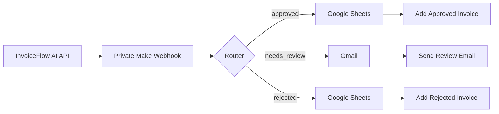
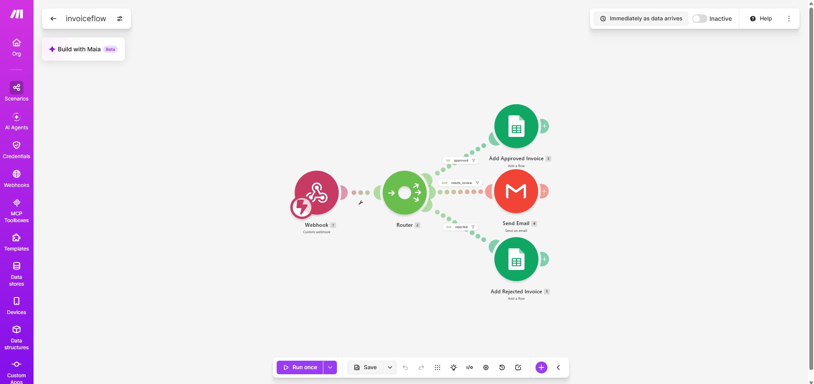
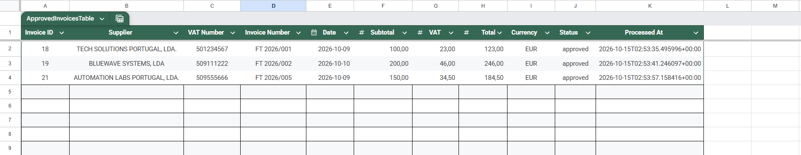
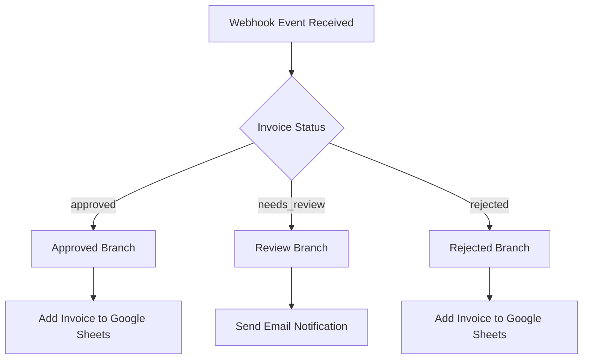
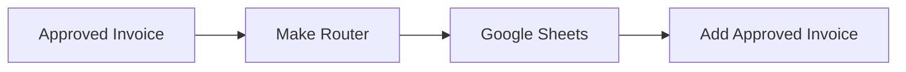
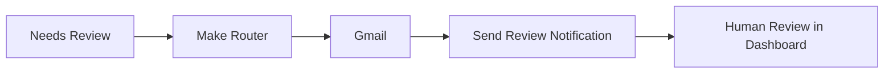
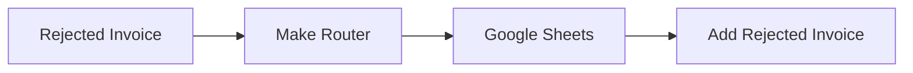
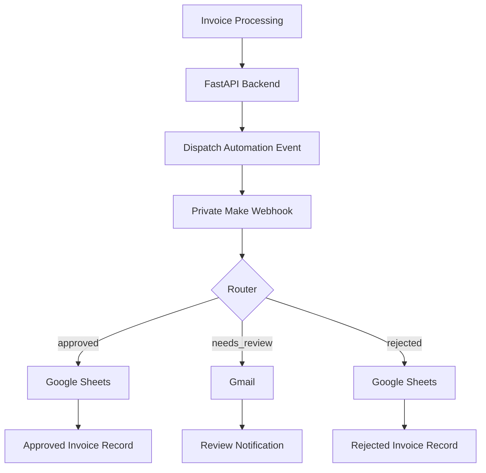

# Make Workflow

This folder documents the Make automation scenario integrated with the InvoiceFlow AI project.

The scenario receives invoice events from the FastAPI backend through a private webhook and routes them according to the invoice status.

---

## Overview

InvoiceFlow AI uses Make as the external workflow automation layer.

After an invoice is processed or its status is updated, the FastAPI backend can dispatch an event to the Make webhook.

The Make scenario evaluates the invoice status and routes the event to the appropriate automation branch.



---

## Workflow Preview

The image below shows the Make scenario used by InvoiceFlow AI.




---

## Automation Result

The screenshot below shows an example of invoice data automatically written to Google Sheets after being routed by the Make scenario.



This demonstrates that the automation flow is not limited to webhook reception and routing: invoice data is also delivered to an external system after processing.

---

## Workflow Routing

The router separates incoming invoice events into three paths:

- `approved`
- `needs_review`
- `rejected`



---

## Approved Invoices

Invoices with the status:

```text
approved
```

are routed to Google Sheets.

The scenario adds the approved invoice to a dedicated spreadsheet using the **Add Approved Invoice** module.

This provides a simple external record of invoices that successfully passed automated or human validation.



---

## Invoices Requiring Review

Invoices with the status:

```text
needs_review
```

are routed to Gmail.

The **Send Email** module can notify a reviewer that an invoice requires manual attention.

The invoice can then be reviewed through the InvoiceFlow AI Streamlit dashboard.



---

## Rejected Invoices

Invoices with the status:

```text
rejected
```

are routed to Google Sheets.

The scenario adds the rejected invoice to a dedicated spreadsheet using the **Add Rejected Invoice** module.

This creates a separate record of invoices rejected during the review process.



---

## Integration With InvoiceFlow AI

The Make workflow is triggered by events sent from the FastAPI backend.



The backend remains responsible for:

- invoice processing;
- AI extraction;
- validation;
- database persistence;
- document storage;
- human review status changes;
- audit logging.

Make is used as the external automation and orchestration layer.

This keeps the core application logic separated from third-party automation workflows.

---

## Security

The Make webhook URL is private and stored as an environment variable:

```text
MAKE_WEBHOOK_URL
```

Webhook authentication is configured through:

```text
MAKE_WEBHOOK_API_KEY
```

Real webhook URLs, credentials and environment-specific configuration are not included in this repository.

The original Make blueprint is intentionally not published because exported scenario files may contain private webhook identifiers or other environment-specific configuration.

---

## Included Files

```text
make-workflows/
├── google-sheets-result.png
├── invoiceflow-workflow.png
└── README.md
```

### `invoiceflow-workflow.png`

Visual reference of the Make scenario architecture.

It demonstrates:

- webhook-based integration;
- conditional routing;
- invoice status handling;
- Google Sheets integration;
- Gmail integration;
- workflow automation outside the core API.

---

### `google-sheets-result.png`

Example of invoice data written to Google Sheets through the Make automation scenario.

It demonstrates:

- successful webhook processing;
- invoice status routing;
- external system integration;
- automated data delivery after invoice processing.

---

## Design Decision

Make was selected to demonstrate how InvoiceFlow AI can integrate with an external process automation platform without coupling automation logic directly to the backend.

This approach allows additional integrations to be added later without changing the core invoice processing pipeline.

Examples could include:

- ERP integrations;
- accounting systems;
- Slack or Microsoft Teams notifications;
- approval workflows;
- additional reporting systems;
- cloud storage;
- other REST APIs.

---

## Note

The screenshot included in this folder is intended only as a visual representation of the workflow structure.

No private webhook URLs, API keys or credentials are stored in this repository.